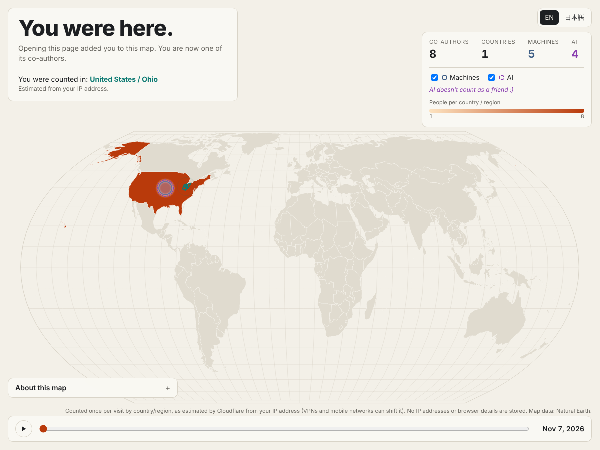

# You were here.

**#30DayMapChallenge 2026 · Day 16 · Collaborative map**

> Do a map with a friend, colleague or a stranger. AI doesn't count as a friend :)

A map drawn by everyone who opens it. Opening the page adds one count to your country/region (as estimated by Cloudflare from your IP address), and you become one of the map's co-authors. Machines that request the page are shown as a separate layer, and AI crawlers are shown but not counted as co-authors.

公開URL: <https://day16-you-were-here.s-nakashima.workers.dev/>



## 作品について

「You were here.（あなたも、ここにいました）」

ページを開いた人の国・地域を数え、見に来た人みんなで1枚の地図を作ります。開いた時点で、その人はこの地図の共同制作者になります。巡回プログラム（機械）も数えて別の層で見せます。そのうち AI の巡回プログラムは、お題の "AI doesn't count as a friend :)" に合わせて、共同制作者には数えない層として見せます。

厳密な集計ではなく、遊びの作品です。

- 世界地図を国ごとの人数で塗り分けます。国をクリックするかズームすると、州・県の単位で表示します。
- 機械と AI は、国の中心に件数に応じた大きさの輪で表示します（切り替え可）。
- 日付のスライダーと再生ボタンで、公開日（2026-11-07）からの広がりを日ごとに見られます。
- 英語が主で、日本語に切り替えられます（`?lang=ja` でも可）。

## 数え方

| 種類 | いつ数えるか | 判定 |
| --- | --- | --- |
| `human`（共同制作者） | ページの JavaScript が動いたときに `/api/hello` へ送る合図で数える | User-Agent が機械と判定されないもの。同じブラウザは1日1回（localStorage に日付の印を残す） |
| `bot`（機械） | ページの HTML が要求されたときに Worker が数える | User-Agent に bot / crawler / spider / preview / curl / wget / python-requests などを含むもの |
| `ai_bot`（AI） | 同上 | GPTBot、ChatGPT-User、OAI-SearchBot、ClaudeBot、Claude-User、Claude-SearchBot、PerplexityBot、Perplexity-User、CCBot、Bytespider、Amazonbot、meta-externalagent、Google-CloudVertexBot など。一覧は [`src/agents.js`](src/agents.js) |

- 国・地域は Cloudflare の `request.cf.country` と `request.cf.regionCode` です。IP アドレスからの推定なので、VPN やスマートフォンの回線ではずれます。
- 州・県の地図は Natural Earth の admin-1 の `iso_3166_2` と `国コード-regionCode` を突き合わせます。対応が取れないものは国の単位でだけ数えます。
- 機械と判定された要求からの `/api/hello` は数えません。
- `/api/stats` は国・地域・種類ごとの合計と日付ごとの合計を JSON で返します（60 秒キャッシュ）。

## 保存しているもの・していないもの

保存しているもの（D1 の `visits` テーブル、[`schema.sql`](schema.sql)）

| 列 | 内容 |
| --- | --- |
| `date` | UTC の日付 |
| `country` | 国コード（不明なら `XX`） |
| `region` | 地域コード（不明なら空） |
| `kind` | `human` / `bot` / `ai_bot` |
| `agent` | 機械のときだけ、判定した種類の名前（`GPTBot` など） |
| `n` | 件数 |

保存していないもの

- IP アドレス
- User-Agent の文字列そのもの、ブラウザの詳しい情報
- Cookie や個人を識別する ID（1日1回の判定はブラウザの localStorage だけで行います）

## 構成

```
src/index.js        Worker（静的ファイルの配信、/api/hello、/api/stats、機械の判定と計数）
src/agents.js       User-Agent の判定表
public/             画面（index.html、app.js、style.css、地図データ、d3、topojson-client）
public/data/        Natural Earth から作った地図データ（scripts/build-data.mjs で生成）
scripts/            地図データの生成、投稿用画像の書き出し
schema.sql          D1 のテーブル
```

## デプロイ

`main` に push すると GitHub Actions（[`.github/workflows/deploy.yml`](.github/workflows/deploy.yml)）が wrangler でテーブルを作成（既にあれば何もしない）し、Worker をデプロイします。

### 1. Cloudflare の API トークンを作る

1. Cloudflare ダッシュボード → 右上のアカウント → **My Profile** → **API Tokens** → **Create Token**
2. **Create Custom Token** を選び、次の権限を付ける
   - Account → **Workers Scripts** → **Edit**
   - Account → **D1** → **Edit**
3. **Account Resources** で対象のアカウントだけを選ぶ
4. 作成したトークンを控える（一度しか表示されません）

アカウント ID は、ダッシュボードの Workers & Pages の画面右側、またはアカウントのホームの **Account ID** で確認できます。

### 2. GitHub の Secrets に登録する

リポジトリの **Settings** → **Secrets and variables** → **Actions** → **New repository secret**

| 名前 | 値 |
| --- | --- |
| `CLOUDFLARE_API_TOKEN` | 1 で作ったトークン |
| `CLOUDFLARE_ACCOUNT_ID` | Cloudflare のアカウント ID |

登録後、**Actions** → **Deploy** → **Run workflow** で手動でも実行できます。

### 3. ローカルで動かす

```sh
npm install
npm run db:init:local
npm run dev        # http://localhost:8787
```

D1 データベースの名前は `day16_you_were_here` です（`wrangler.toml`）。別のアカウントに作り直す場合は `npx wrangler d1 create day16_you_were_here` で作成し、`wrangler.toml` の `database_id` を書き換えてください。

### 地図データを作り直す

```sh
npm run build:data
```

## 投稿用の画像

その時点の地図を 1200×1200 の PNG（英語）に書き出します。

```sh
npm i --no-save playwright && npx playwright install chromium
node scripts/export-image.mjs https://day16-you-were-here.s-nakashima.workers.dev docs/day16.png
# 日付を指定する場合（その日までの累計）
node scripts/export-image.mjs https://day16-you-were-here.s-nakashima.workers.dev docs/day16.png 2026-11-16
```

GitHub Actions の **Export image** でも書き出せます（11月16日 09:00 JST に自動実行、手動実行も可）。画像は実行結果の Artifacts に添付されます。別の URL を使う場合は、リポジトリの変数 `SITE_URL` か手動実行時の入力で指定します。

投稿後も数え続けます。

## 出典

- 地図データ: [Natural Earth](https://www.naturalearthdata.com/)（パブリックドメイン）。Admin 0 – Countries（1:50m）、Admin 1 – States, Provinces（1:10m）を簡略化して使用。
- 位置: Cloudflare の IP アドレスによる推定（`request.cf`）。
- ライブラリ: [D3](https://d3js.org/)（ISC）、[topojson-client](https://github.com/topojson/topojson-client)（ISC）。

## License

MIT（コード）。地図データは Natural Earth（パブリックドメイン）。
